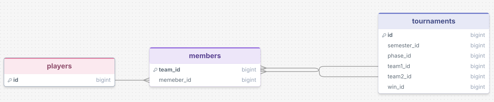
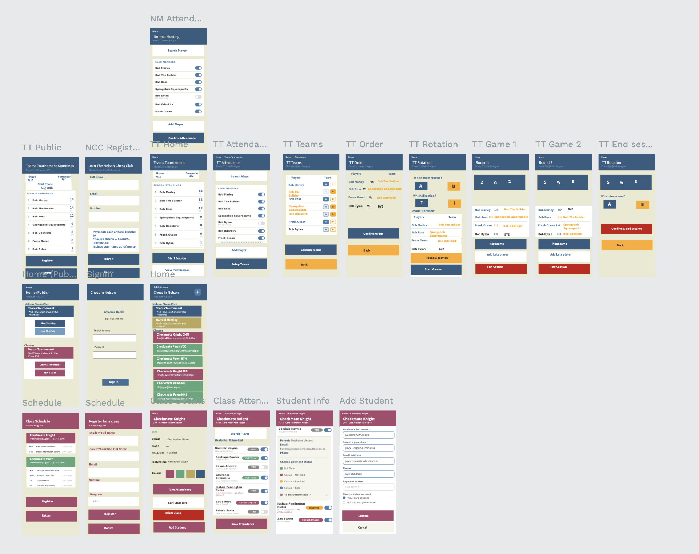

# Sprint 1 - Developing a DB and UI Prototype

## Sprint Goals

Develop a design for the database and a UI prototype that simulates the key functionality of the system. Test and refine the UI so that it can serve as the model for the next phase of development in Sprint 2.

### Specific Goals

**Edit these goals as needed**

Design the database: 
players, members, tournaments, with keys and relationships in DrawSQL
Learn how Rami moves through a meeting, for TTs, normal meetings and classes
Design every key screen (yes. EVERY screen) in Penpot, mobile first
Apply the Chess in Nelson colour palette
Get Rami's sign-off before writing any code

## Initial Database Design

### Required Data Input

Rami types everything: attendance, team choices, results, new player names and payment status. Current data sits
in his Google Sheet. Players don't enter anything (as range of technical skill): "they show up, pay, and play."
### Required Data Output

Public: TT standings and past sessions. Rami only: attendance, teams, payment status and normal meetings.

### Required Data Processing

The winning team sets each player's points (1 for a win, 0 for a loss, via Rami's rule). A player's total is the sum for
the semester, shown highest first.

## UI 'Flow'
(https://design.penpot.app/?screen=viewer&file-id=f0485fb1-4e63-8165-8008-3908ecdf26ed&page-id=f0485fb1-4e63-8165-8008-3908ecdf26ee&section=interactions&index=0&share-id=8eb0d2a8-0b64-4a30-ae12-a8f9f2afbf5f)

**Penpot FLOW - PLACE THE Penpot EMBED CODE HERE - MAKE SURE IT IS SET SO THAT EVERYONE CAN ACCESS IT**

### Testing

"to take attendance I need to go through Classes > View Classes > select the course > presumably select
the venue > Take Attendance. It feels like quite a few steps for something I'll be doing all the time."

"Once I'm on the attendance screen, I'd like to see all the students and have another + button to add a new
student."

"A semester is the 6-month duration of each Teams Tournament. A phase refers to each individual Teams
Tournament meeting." (found that confusing but aight)

### Changes / Improvements

Home lists every activity at once, with a + in the top right, and classes
in the order he gave

Attendance lists with toggles, plus Add Player and Add
Student

Headers has Phase 7/10, Semester 1/2 (hard coded atm)

*IMPROVED FIGMA FLOW - PLACE THE FIGMA EMBED CODE HERE - MAKE SURE IT IS SET SO THAT EVERYONE CAN ACCESS IT*

## Initial UI Prototype

(https://design.penpot.app/?screen=viewer&file-id=3be9e5e1-190f-8090-8008-6f22d76b3a53&page-id=3be9e5e1-190f-8090-8008-6f22d76b3a54&section=interactions&index=0&share-id=81f57451-85cc-819d-8008-7b29f832a3e2)

*FIGMA PROTOTYPE - PLACE THE FIGMA EMBED CODE HERE - MAKE SURE IT IS SET SO THAT EVERYONE CAN ACCESS IT*

### Testing

Rami replied on the 19th of August with the following: 

"Members shoudnt be able to register themselves."

"Unlike most real tournaments a BYE player doesnt get a point."
(doesnt matter as team score entered manually anyway)

"I want the process to be as simple as possible. Players show up, and play. No extra steps."

### Changes / Improvements

Note that the following were agreed by email and never redrawn: 

NCC (nelson chess club) join club removed.

To keep things as simple as possible, instead of having captains and tracking all games I suggested simply having two teams, tracking the score in person, ane enter results manually. 

Classes: Removed as we agreed I would focus on Teams tournaments and Normal meetings first. 

## Sprint Review

I had quite a lot of push back trying to get rid of captains and having no need for Rami's google form (instead of simply making another form). However, after a few trial rounds, he was happy with the out come of my design. 

