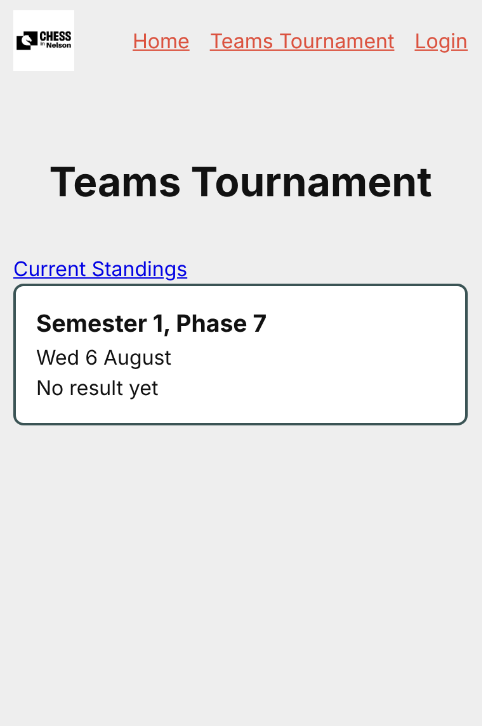
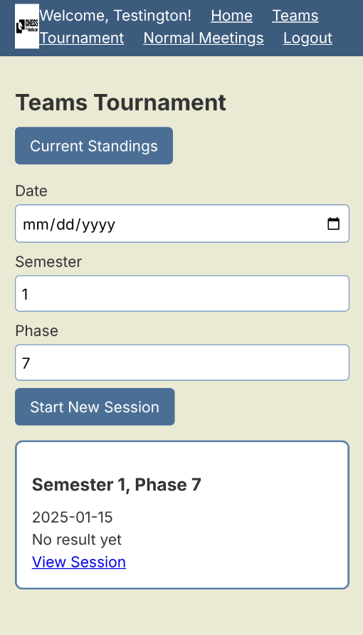
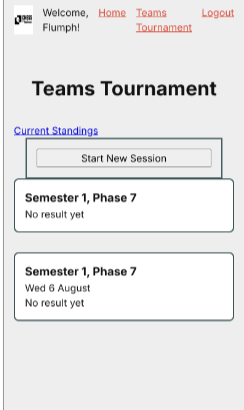
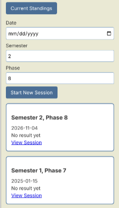
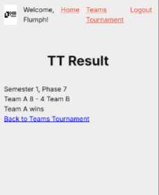
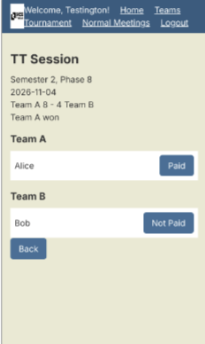

# Sprint 2 - Implement Database and Display of Test Data

## Sprint Goals

Implement the database, populated with test data. Create queries that retrieve test data, and display this on web pages as needed. Test and refine the queries and data display, so that it stands as the basis of the next sprint.

### Specific Goals

**Edit these goals as needed**

- Implement the database: users, players, members, tournaments
- Add test data to the database
- Create the following web pages:
    - Home pages showing Teams Tournament info
- Develop SQL database queries to:
    - Retrieve all the latest tournament and a user by username
    - protect admin routes with a log in. 

## Testing new session routes

testing whether /tournaments works with

### Changes / Improvements

Made a form so that Rami can add date manually rather than the previous hard-coded date

## Testing session card

Testing that the card for each session produce the desired outcome

### Changes / Improvements

each card got a view session route so that past info is accesable 

## Testing payments

Rami wanted a systen to track payments. This system has been sitting idle in the DB for a while. 

### Changes / Improvements

added paid/not paid toggle for payment status' of players 

## ETC...

## Sprint Review

This sprint tackeled the DB, test data and login, pages, etc. which gave me a base to build the rest on. Testing found 3 real problems: new sessions had no real date (originally hard coded as I just wanted to get a draft done),  session cards didnt have any way to see previous info, payment was in DB but never really used. All 3 fixed, Rami happy with simplicity and workflow of all. 

