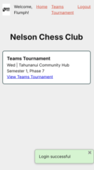
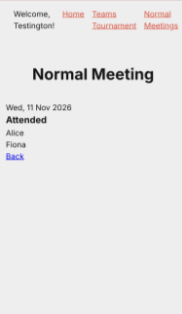
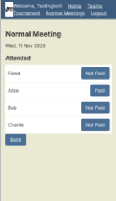

# Sprint 3 - Developing a Minimum Viable Product (MVP)

## Sprint Goals

Continue to develop the web application to the point that it provides all key functionality of the system. Test and refine it so that it can serve as the basis for the final phase of development.

### Specific Goals

**Edit these goals as needed**

- Create the following web pages:
    - Form for Normal meeting home, with a form to start a meeting
    - Meeting attendance, search, toggles to add player/payments
- Develop SQL database queries to:
    - Add a new meeting to tournaments (table) with type NM 
    - add and remove attendees in members (table)
    - Update payment status'

## Testing NM route 

Rami needs a system for every second wednesday when we "dont have a tournament or TT scheduled." This system is NM (normal meetings) wherein the only thing that needs to be tracked are the players who went the date. 

### Changes / Improvements

Added routes for NM (e.g. meeting, attendance)

## Testing Payments

testing whether admin can check who still owes money for a meeting 

### Changes / Improvements

added toggle for payments to NM cards; paid/nt paid

## Sprint Review

This sprint got Normal Meetings working; before this the meeting route was just full of 404's. Rami can now start a meeting, mark who came and see who still owes him, which is what he wanted payments for as a whole. Along with the TT workflow, that covers the main things he does during a club session.

