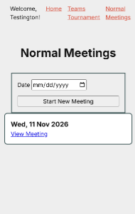
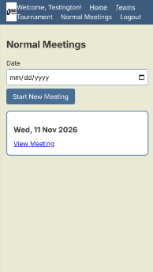
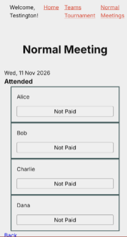
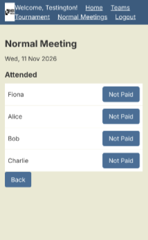
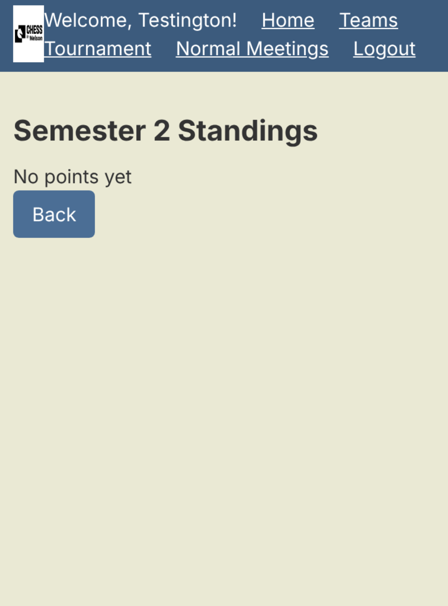
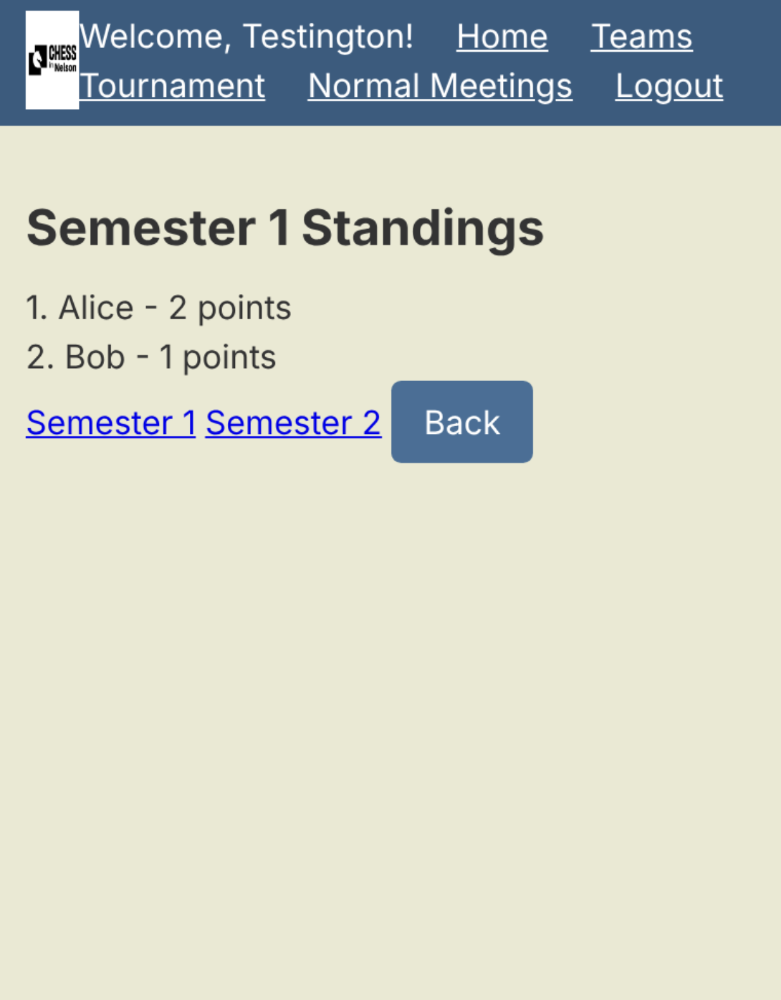

# Sprint 4 - Developing a Refined and Complete System

## Sprint Goals

Develop the system until it is fully featured, with a refined UI and it satisfies the requirements. The system will be fully tested at this point.

### Specific Goals

**Edit these goals as needed**

- Refine the design and UI of the website: Use Rami's colour pallete 
- Refine the user experience (UX) of the system to make it work for his phone
- Perform final, full-system testing

## Testing NM phone view

Uses Rami's pallete on a phone 

### Changes / Improvements

rewrote styles.css to fit Rami's colour pallete 

## Testing player payments

should be same as the TT cards for payment: one row per player with a toggle for payments. 

### Changes / Improvements

moved the css style into section form so that attendance, teams, session, etc along with all meetings pages actually match. 

## Testing standings/end of semester

Testing what happens to player rankings when a new semester starts.

### Changes / Improvements

Added a link for each semester on the standings page. Of course works logged out too. So not just admin.

## Sprint Review

This sprint made the app actually look something of Rami's own creation as well as work on his phone. One rewrite of styles sorted the colours, the header and the player rows. Testing the end of a semester also showed that old rankings do in fact dissappear once a new semester is started.
